# Trabajo práctico: Logging y detección de incidentes de seguridad en Laravel

**Materia:** Programación IV, Tecnicatura Universitaria en Programación (UTN)
**Alumno:** Diego
**Fecha:** noviembre de 2026

---

## 1. Objetivo

Registrar los intentos de autenticación de una aplicación Laravel, identificar patrones sospechosos (intentos fallidos reiterados desde una misma IP), aplicar una respuesta automática (bloqueo temporal) y analizar la evidencia para justificar decisiones de seguridad.

## 2. Entorno de trabajo

| Elemento | Detalle |
|---|---|
| Sistema operativo | Linux Mint |
| Framework | Laravel (versión: completar con `php artisan --version`) |
| Base de datos | MySQL |
| Administración de la base | phpMyAdmin |
| Caché | `CACHE_STORE=database` |
| Autenticador | Controlador propio `SecurityLoginController` con `Auth::attempt()` |
| Ruta del login | `GET /security-login` (formulario) y `POST /security-login` (autenticación) |
| Ruta del panel | `GET /security-dashboard` (protegida con `auth` y `can:viewSecurityDashboard`) |

## 3. Reglas de detección implementadas

| Condición (por IP, en 5 minutos) | Respuesta del sistema |
|---|---|
| Autenticación correcta | `INFO` y registro `success` |
| 1 a 2 fallos | `WARNING` y registro `failed` |
| 3 a 4 fallos | `ALERT`: posible ataque de fuerza bruta |
| 5 fallos | Bloqueo temporal de 10 minutos y `CRITICAL` |
| IP bloqueada | HTTP 429, `WARNING` y registro `blocked` |

Los niveles utilizados corresponden al estándar **RFC 5424** (Syslog), donde un número menor indica mayor gravedad: `CRITICAL (2)`, `ALERT (1)`, `WARNING (4)` e `INFO (6)`.

## 4. Implementación

### 4.1 Canal de logs de seguridad
En `config/logging.php` se agregó el canal `security` con driver `daily`, que genera un archivo por día (`storage/logs/security-AAAA-MM-DD.log`), nivel mínimo `info` y retención de 30 días. Así los eventos de autenticación quedan separados del log técnico general (`laravel.log`).

### 4.2 Tabla de auditoría `login_attempts`
Se creó con una migración y el modelo `LoginAttempt`. Columnas: `id`, `identifier` (email ingresado), `ip_address`, `status` (`success`, `failed` o `blocked`), `user_agent` y `created_at`. Se definió un índice compuesto sobre `ip_address`, `status` y `created_at`, que son las columnas usadas para contar fallos por IP en una ventana de tiempo.

### 4.3 Controlador `SecurityLoginController`
Flujo del método `login`:
1. Valida email y contraseña.
2. Si la IP tiene un bloqueo vigente en caché, registra `blocked` y responde HTTP 429 **sin intentar la autenticación**.
3. Si `Auth::attempt()` es correcto, regenera la sesión (protección contra *session fixation*), registra `success` y escribe `INFO`.
4. Si falla, registra `failed`, cuenta los fallos de la IP en los últimos 5 minutos y escribe `WARNING`.
5. Con 5 o más fallos guarda el bloqueo en caché por 10 minutos y escribe `CRITICAL`; con 3 o 4 escribe `ALERT`.

### 4.4 Formulario de prueba
Vista `security-login.blade.php` con protección CSRF (`@csrf`), que no fue deshabilitada.

### 4.5 Panel de monitoreo
`SecurityDashboardController` muestra la cantidad de eventos `success`, `failed` y `blocked` de las últimas 24 horas y una tabla con las IP que tienen 3 o más fallos en 5 minutos, clasificadas como ALERTA o CRÍTICO. El acceso está restringido con el Gate `viewSecurityDashboard`, definido en `AppServiceProvider`, que solo autoriza a los emails de una lista definida (en esta versión, el usuario de prueba). En un sistema real se usaría un sistema de roles.

## 5. Pruebas obligatorias

Las pruebas se realizaron el 04/11/2026 en entorno local (`php artisan serve`, IP `127.0.0.1`) con un usuario de prueba. Durante las pruebas se dejó abierto `tail -f storage/logs/security-*.log` para observar los eventos en tiempo real.

**Nota sobre los horarios:** durante estas pruebas Laravel usaba su zona horaria por defecto, UTC, por lo que los horarios del log están 3 horas adelantados respecto de la hora de Argentina (por ejemplo, 20:21 UTC equivale a 17:21 en Argentina). Después se configuró `APP_TIMEZONE=America/Argentina/Buenos_Aires`.

| # | Prueba | Resultado esperado | Resultado obtenido |
|---|---|---|---|
| 1 | Login válido | INFO y registro `success` | 20:14:56: `INFO Inicio de sesión exitoso`, respuesta "Autenticación correcta", panel con 1 exitoso. ✔ |
| 2 | Dos contraseñas incorrectas | Dos WARNING y dos registros `failed` | 20:21:31 y 20:21:40: dos `WARNING Autenticación fallida` (`failed_attempts` 1 y 2), panel con 2 fallidos. ✔ |
| 3 | Tres fallos en cinco minutos | ALERT por posible fuerza bruta | 20:21:45: `WARNING` con `failed_attempts: 3` y `ALERT Posible ataque de fuerza bruta`. El panel muestra `127.0.0.1` con 3 fallos clasificada como ALERTA. ✔ |
| 4 | Cinco fallos en cinco minutos | Bloqueo de 10 minutos y CRITICAL | 20:21:51: cuarto fallo con `ALERT`. 20:21:59: quinto fallo y `CRITICAL Bloqueo temporal por intentos fallidos` con `duration_minutes: 10`. ✔ |
| 5 | Acceso con IP bloqueada | HTTP 429 y registro `blocked` | 20:22:19: respuesta "Acceso temporalmente restringido." (HTTP 429) y `WARNING Intento desde IP bloqueada`. El panel muestra 1 bloqueado. ✔ |
| 6 | Acceso tras vencer el bloqueo | Autenticación habilitada nuevamente | 20:36:05 (14 minutos después del bloqueo): `INFO Inicio de sesión exitoso`. El bloqueo venció solo. ✔ |

### Prueba 1: Login válido
Respuesta del servidor:

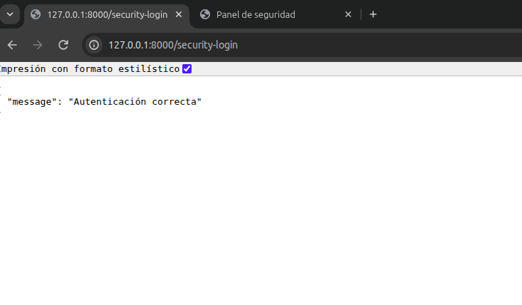

Panel después del login válido:

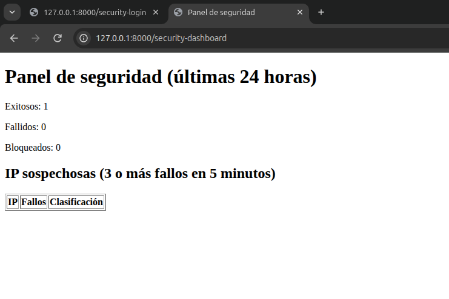

### Prueba 2: Dos contraseñas incorrectas
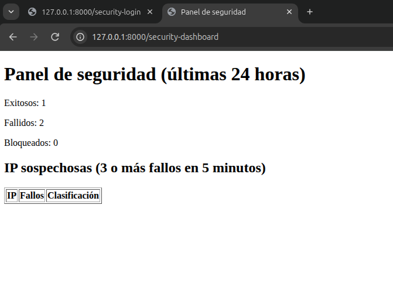

### Prueba 3: Tres fallos en cinco minutos
La IP aparece en la tabla de IP sospechosas con clasificación ALERTA.

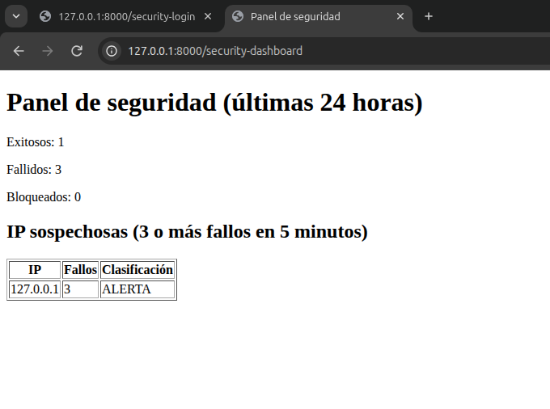

### Pruebas 4 y 5: Bloqueo e intento con IP bloqueada
Respuesta del servidor al intentar ingresar con la IP bloqueada:

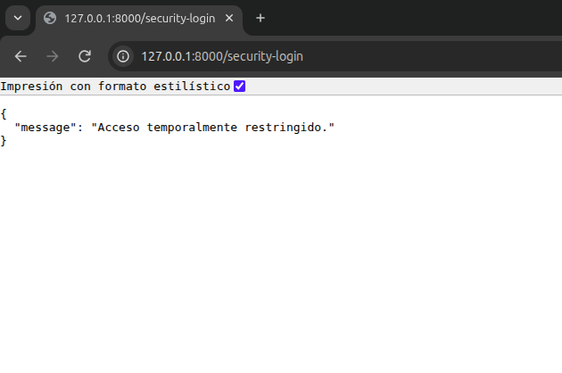

Panel después del bloqueo: 5 fallidos y 1 bloqueado.

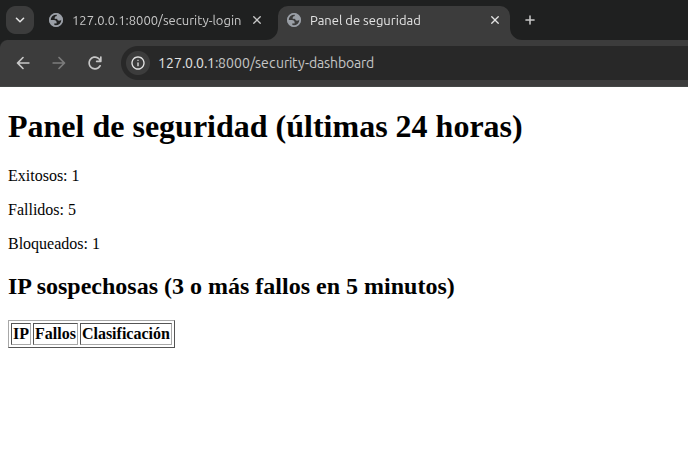

**Observación:** en esta captura la tabla de IP sospechosas aparece vacía aunque hubo 5 fallos. Esto es correcto: la tabla solo considera los fallos de los **últimos 5 minutos**, y la captura se tomó después de que pasara esa ventana. Los contadores superiores, en cambio, abarcan 24 horas. Esto muestra que la detección funciona con una "ventana deslizante" de tiempo.

### Registro completo en el log de seguridad (pruebas 1 a 6)
El archivo `storage/logs/security-2026-11-04.log` muestra la secuencia completa con sus niveles: INFO, WARNING, ALERT, CRITICAL, el intento bloqueado y el nuevo login exitoso tras vencer el bloqueo.

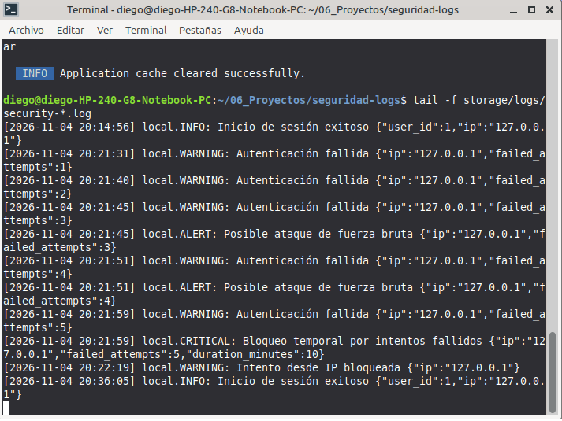

## 6. Consultas para detectar patrones

Las consultas se ejecutaron en phpMyAdmin sobre la base `seguridad_logs`.

**Últimos eventos**
```sql
SELECT * FROM login_attempts
ORDER BY created_at DESC
LIMIT 20;
```
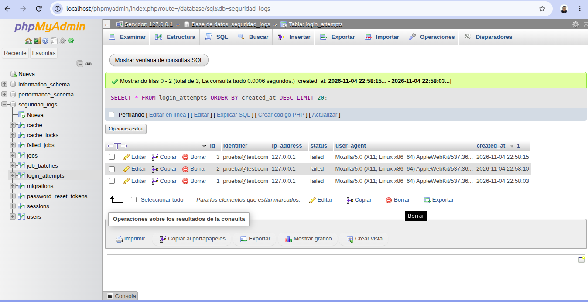

**Fallos acumulados por IP**
```sql
SELECT ip_address, COUNT(*) AS total_fallos
FROM login_attempts
WHERE status = 'failed'
GROUP BY ip_address
ORDER BY total_fallos DESC;
```
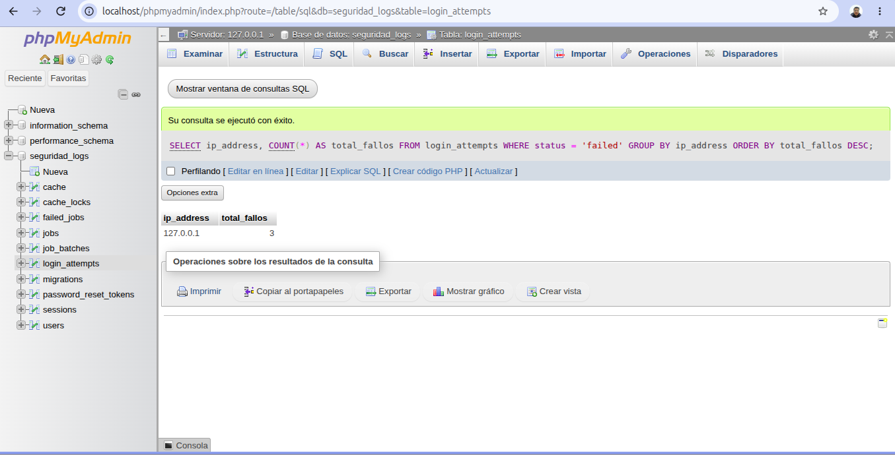

**IP sospechosas (3 o más fallos en 5 minutos)**
```sql
SELECT ip_address, COUNT(*) AS total_fallos
FROM login_attempts
WHERE status = 'failed'
  AND created_at >= NOW() - INTERVAL 5 MINUTE
GROUP BY ip_address
HAVING COUNT(*) >= 3;
```
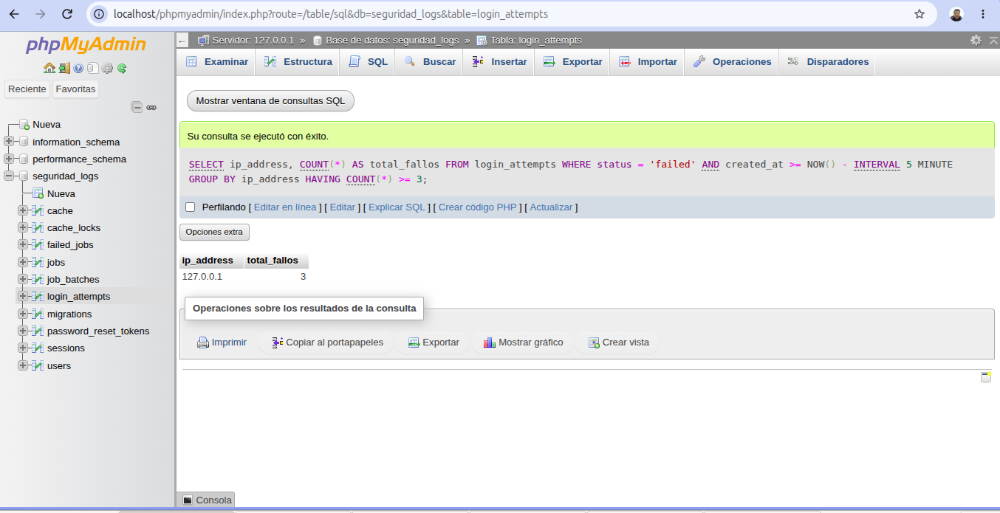

## 7. Análisis y decisiones de seguridad

**¿Qué IP concentra los fallos?**
La IP `127.0.0.1`, con 5 fallos entre las 20:21:31 y las 20:21:59, es decir, en menos de 30 segundos. Es la dirección local de mi propia computadora, porque las pruebas se hicieron en entorno local: el "atacante" fui yo mismo simulando el escenario. En un sistema publicado en internet, en esa columna aparecerían las IP públicas de quienes intentan ingresar.

**¿Puede afirmarse que existe un ataque?**
No con certeza. El sistema detecta un patrón sospechoso, pero un patrón no es una prueba. Cinco fallos seguidos pueden ser un intento de fuerza bruta, pero también un usuario que olvidó su contraseña o que tiene activado Bloq Mayús. Lo que sí indica comportamiento automatizado es la velocidad: 5 intentos en menos de 30 segundos es poco habitual para una persona. Para afirmar que hay un ataque haría falta más evidencia: cientos de intentos, muchos emails distintos desde la misma IP, o la misma cuenta atacada desde muchas IP.

**¿Qué efectos tendría bloquear una IP compartida?**
Muchas personas pueden salir a internet con la misma IP pública: el wifi de la facultad, una empresa, un cíber o la red de una operadora móvil. Si una sola de ellas falla 5 veces, el bloqueo afecta a todas durante 10 minutos, aunque no hayan hecho nada. Es un "falso positivo" que perjudica a usuarios legítimos. Además, un atacante podría aprovecharlo a propósito para dejar sin acceso a toda una red (denegación de servicio). Por eso el bloqueo es temporal y conviene combinarlo con límites por cuenta.

**¿Qué evidencias adicionales se necesitan?**
- El **identificador** (email): si se prueban muchos emails distintos desde una IP, es un ataque de enumeración; si siempre es el mismo, es un ataque dirigido a una cuenta.
- El **user agent**: si no parece un navegador (por ejemplo `curl` o `python-requests`), indica un script automatizado.
- Si hubo un **login exitoso después de varios fallos**: podría significar que el atacante adivinó la contraseña y la cuenta está comprometida.
- La **frecuencia y el horario** de los intentos, y si la misma cuenta recibe intentos desde **varias IP** (ataque distribuido).
- Información externa: reputación de la IP, país de origen, y los logs del servidor web o del firewall.

**¿Qué respuestas conviene automatizar y cuáles requieren revisión humana?**
Conviene automatizar las respuestas rápidas, temporales y reversibles: registrar los eventos, generar alertas, bloquear una IP por algunos minutos y notificar al equipo de seguridad. Si el sistema se equivoca, el daño es pequeño y se corrige solo. En cambio, las decisiones graves o definitivas requieren revisión humana: bloquear una IP o una cuenta de forma permanente, forzar el cambio de contraseña, avisar a un usuario que su cuenta fue comprometida o denunciar un incidente. Esas acciones necesitan que una persona analice la evidencia y el contexto antes de decidir.

## 8. Mejoras implementadas (actividad integradora)

Se eligieron dos mejoras: **detección por cuenta** y **exportación de evidencias**.

### 8.1 Detección por cuenta

**Problema que resuelve:** el sistema original solo cuenta fallos por IP. Un atacante que cambie de IP en cada intento (ataque distribuido) nunca llega al límite y no es detectado.

**Solución:** además de contar por IP, se cuentan los fallos de un mismo identificador (email) en los últimos 15 minutos, sin importar desde qué IP vengan. Con 3 o más fallos se registra un `ALERT` de posible ataque dirigido a esa cuenta. Para no exponer datos personales en el log, el email se registra como hash `sha256`.

En `SecurityLoginController`, dentro del método `login`, después de `$this->record($request, 'failed');` se agregó:

```php
// Mejora 1: detección por cuenta
$email = mb_strtolower($data['email']);

$accountFailures = LoginAttempt::where('identifier', $email)
    ->where('status', 'failed')
    ->where('created_at', '>=', now()->subMinutes(15))
    ->count();

if ($accountFailures >= 3) {
    Log::channel('security')->alert('Posible ataque dirigido a una cuenta', [
        'account_hash' => hash('sha256', $email),
        'failed_attempts' => $accountFailures,
        'window_minutes' => 15,
    ]);
}
```

**Decisión de diseño:** ante un ataque a una cuenta solo se genera una alerta y no se bloquea la cuenta automáticamente. Bloquear la cuenta permitiría que cualquiera deje sin acceso a un usuario legítimo solo con conocer su email; esa decisión queda para revisión humana.

**Prueba:** se hicieron 3 intentos fallidos con el mismo email y el log registró el `ALERT Posible ataque dirigido a una cuenta` con el hash del email.

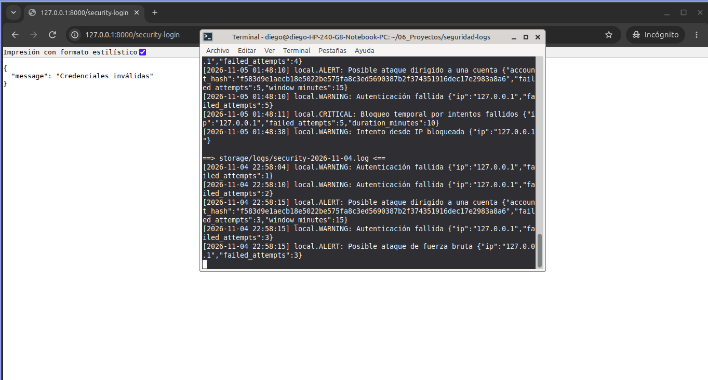

### 8.2 Exportación de evidencias

**Problema que resuelve:** ante un incidente, el equipo de seguridad necesita entregar evidencia (por ejemplo, a un superior o a un auditor). Copiar datos a mano desde la base es lento y propenso a errores.

**Solución:** desde el panel de monitoreo se puede descargar un archivo CSV con todos los intentos de autenticación de las últimas 24 horas. La ruta usa la misma protección que el panel (`auth` y `can:viewSecurityDashboard`), y cada exportación queda registrada en el log de seguridad con el usuario que la hizo, para saber quién accedió a la evidencia.

En `SecurityDashboardController` se agregó el método:

```php
public function export()
{
    $attempts = LoginAttempt::where('created_at', '>=', now()->subHours(24))
        ->orderBy('created_at')
        ->get();

    Log::channel('security')->notice('Exportación de evidencias', [
        'user_id' => auth()->id(),
        'records' => $attempts->count(),
    ]);

    $filename = 'evidencias-' . now()->format('Y-m-d_His') . '.csv';

    return response()->streamDownload(function () use ($attempts) {
        $out = fopen('php://output', 'w');
        fputcsv($out, ['id', 'identifier', 'ip_address', 'status', 'user_agent', 'created_at']);
        foreach ($attempts as $a) {
            fputcsv($out, [$a->id, $a->identifier, $a->ip_address, $a->status, $a->user_agent, $a->created_at]);
        }
        fclose($out);
    }, $filename, ['Content-Type' => 'text/csv']);
}
```
(Arriba del archivo se agregó `use Illuminate\Support\Facades\Log;`.)

En `routes/web.php`:

```php
Route::get('/security-dashboard/export', [SecurityDashboardController::class, 'export'])
    ->middleware(['auth', 'can:viewSecurityDashboard']);
```

En `security-dashboard.blade.php` se agregó un enlace "Exportar evidencias (CSV)" que apunta a `/security-dashboard/export`.

**Prueba:** desde el panel se descargó el archivo CSV con los intentos registrados, y el log de seguridad registró el evento `NOTICE Exportación de evidencias` con el usuario que la realizó. Al intentar acceder a la ruta sin iniciar sesión, el sistema redirige al login.

El log registra el inicio de sesión del administrador (23:10:26) y la exportación con la cantidad de registros incluidos (23:11:14, `records: 4`):

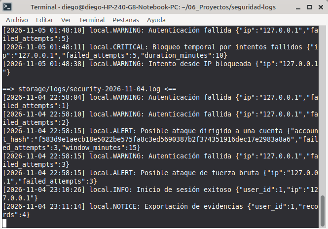

El archivo exportado se incluye como evidencia en [evidencias/evidencias-exportadas.csv](evidencias/evidencias-exportadas.csv). Contiene los 3 intentos fallidos y el inicio de sesión exitoso de la prueba, con identificador, IP, estado, navegador y fecha de cada uno.

## 9. Límites de la implementación

Este prototipo es educativo y tiene limitaciones conocidas:

- **No es atómico ni resiste concurrencia:** dos pedidos simultáneos pueden contar los fallos al mismo tiempo y superar el límite. En producción se usaría el `RateLimiter` de Laravel con Redis.
- **El bloqueo es solo por IP:** la detección por cuenta (mejora 1) genera alertas pero no bloquea, y varios usuarios legítimos detrás de una misma IP pueden ser bloqueados juntos. En producción conviene combinar límites por IP y por cuenta con el `RateLimiter` de Laravel.
- **Proxies:** si la aplicación está detrás de un proxy o balanceador, `$request->ip()` puede devolver la IP del proxy. Hay que configurar los proxies confiables.
- **Datos personales:** se guarda el email en texto plano. Para minimizar datos personales podría guardarse un hash (`sha256`) del identificador. Nunca se guardan contraseñas ni tokens.
- **Retención e integridad:** los logs se conservan 30 días y no están protegidos contra modificación. En un sistema real se enviarían a un almacenamiento externo o a un SIEM.
- **Logs técnicos no son auditoría:** el log registra lo que ocurrió, pero una auditoría completa necesita eventos de negocio estructurados y protegidos.

## 10. Conclusión

Este trabajo me permitió ver que un sistema sin logs no tiene memoria: si no se registra lo que pasa, no hay forma de saber si alguien intentó entrar ni de reconstruir un incidente después. Separar los eventos de seguridad en un canal propio y guardarlos también en una tabla hizo posible no solo leerlos, sino consultarlos y detectar patrones, como varios fallos seguidos desde una misma IP.

También entendí la diferencia entre detectar y responder. Los niveles del RFC 5424 (WARNING, ALERT, CRITICAL) permiten clasificar la gravedad de cada evento, y el bloqueo temporal es una respuesta automática que frena un ataque de fuerza bruta sin intervención humana. Las pruebas confirmaron que cada regla funciona como se esperaba, incluso que una IP bloqueada no puede entrar aunque use la contraseña correcta.

Al mismo tiempo, la implementación tiene límites: una IP no identifica a una persona, por lo que bloquear una IP compartida puede afectar a usuarios legítimos, y el sistema no resiste solicitudes concurrentes. Para un entorno real usaría el RateLimiter de Laravel con Redis, combinaría límites por IP y por cuenta, y protegería los logs en un almacenamiento externo. Las decisiones graves, como bloquear una cuenta de forma permanente, deberían quedar en manos de una persona que analice la evidencia.
